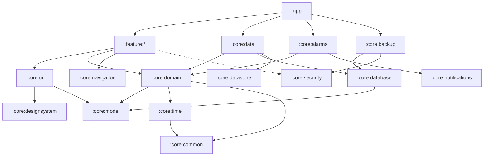

# Hayat — Architecture Blueprint

> Status legend used across all docs: **Implemented** (code exists, compiles, tests pass),
> **Partial** (code exists, known gaps listed), **Planned** (designed, not built),
> **Unverified on device** (compiles and passes JVM/Robolectric tests, but has not
> run on a physical device or emulator — the build environment has no KVM).

## 1. Product requirements (summary)

| Item | Requirement |
|---|---|
| Name / tagline | Hayat — *Your Life, Organized.* |
| Platform | Android only, minSdk 26, targetSdk 37, compileSdk 37.2 |
| Connectivity | 100 % offline. **No `INTERNET` permission.** No accounts, backend, Firebase, analytics or ads. |
| Languages | English (default resource set) and Bengali (`values-bn`), switchable in-app via per-app locales. |
| Users | Bangladesh first, internationally usable. Muslim and non-Muslim users: the Islamic module is optional and off by default unless enabled in onboarding/settings. |
| Data | All user data in a local Room database and Jetpack DataStore. Android auto-backup and device-transfer extraction are disabled; the user owns backups through explicit, optionally encrypted export files (Storage Access Framework). |
| Reliability | Reminders are persisted before scheduling, occurrences are recorded separately from delivery and completion, and schedules are reconciled after reboot, app update, time/zone change and periodically. Exact timing depends on Android permissions and OEM power management; the UI says so. |

### Feature inventory

Core: onboarding, dashboard (configurable cards), calendar (day timeline, week, month),
universal add sheet, tasks (+subtasks, tags, categories, recurrence), routines
(+activities, completion log, conflict detection, templates), universal reminder engine,
alarm engine, search, analytics, settings, backup/restore, app lock.

Lifestyle modules: water, medicine, diet/meals (+shopping list), sleep, fitness,
study + Pomodoro focus, finance reminders, events/important dates, notes + journal + mood,
habits, Ibadah (prayer log, offline prayer times, zikr counters, Quran reading log and
goal, fasting log, Hijri date).

## 2. Architecture decisions (ADR log)

| # | Decision | Reasoning |
|---|---|---|
| ADR-1 | **Toolchain: AGP 9.5.2, Gradle 9.9.2, Kotlin 2.4.21, KSP 2.3.14, compileSdk 37.2.** | Latest stable, verified in the build environment by a spike build before adoption. The 2026.08+ AndroidX wave requires AGP ≥ 9.1 and compileSdk ≥ 37.1. |
| ADR-2 | Clean Architecture + MVVM + UDF. Presentation → domain contracts ← data implementations. | Testable business logic; presentation never sees Room or AlarmManager. |
| ADR-3 | **Repository contracts and use cases live in one `:core:domain` JVM module**, implementations in `:core:data`. Feature modules contain presentation only. | The prompt's per-feature `data/domain` folders would duplicate contracts (many features share reminders, categories, analytics). A single pure-Kotlin domain module keeps the dependency graph acyclic and fast to test. |
| ADR-4 | Related features are grouped: `ibadah` = prayer + zikr + Quran + fasting + Hijri; `notes` = notes + journal + mood; `study` = study + focus timer. | Shared settings/state; avoids ~6 extra Gradle modules with no isolation benefit. |
| ADR-5 | One Room database (`HayatDatabase`), schema exported to `core/database/schemas`, **no destructive migrations**. | Cross-feature transactions (e.g. backup restore, reminder ↔ medicine linking) need one DB. |
| ADR-6 | Wall-clock rules are stored as local date/time + zone policy; occurrences are stored as UTC epoch-millis instants. | Required to handle DST, time-zone changes and travel correctly (see `alarm-engine.md`). |
| ADR-7 | **One pending OS alarm per reminder** (its next due occurrence), occurrences materialised for a bounded 7-day horizon (max 200 per reminder), global cap of 400 OS alarms. | Stays well under Android's 500-alarm-per-app limit, PendingIntent identity per reminder gives natural de-duplication. |
| ADR-8 | `SCHEDULE_EXACT_ALARM` only (not `USE_EXACT_ALARM`); graceful fallback to inexact `setAndAllowWhileIdle`. | Least privilege, Play policy-safe. Precision actually used is recorded per occurrence and shown to the user. |
| ADR-9 | Search uses SQL `LIKE` substring matching with escaping instead of FTS. | SQLite FTS tokenizers split Bengali words at combining vowel signs on some builds; substring matching is correct for Bengali and fast enough for personal datasets. Tested with Bengali text. |
| ADR-10 | Database is **not** additionally encrypted with SQLCipher in v1. Protection = app sandbox + Android file-based encryption + no backup extraction + optional app lock + encrypted exports. | An attacker with root can use the app's own Keystore keys, so the marginal benefit is small, while a Keystore failure would make the DB unreadable (data-loss risk), and native-library integration could not be verified on a device here. Revisit with device testing (`known-limitations.md`). |
| ADR-11 | Prayer times via the MIT-licensed **Adhan** library (`com.batoulapps.adhan:adhan:1.2.1`), manual city/coordinates, no location permission. | Validated, widely used algorithm; avoids GPS. |
| ADR-12 | Hijri dates via `java.time.chrono.HijrahDate` (Umm al-Qura) plus a user day-offset (−2…+2). | Documented offline algorithm; offset accommodates local moon sighting. |
| ADR-13 | Religious text bundled is limited to short, universally known phrases (tasbih, takbir, tahlil, istighfar, a short durood) and the 114 surah names with verse counts (sum-checked = 6236 in tests). No Quran verses, hadith or long duas are bundled. | Avoids unverified religious text. Users can add their own adhkar. |
| ADR-14 | Navigation Compose with type-safe `@Serializable` routes defined in `:core:navigation`. | Features navigate to each other without depending on each other. |
| ADR-15 | Font: Hind Siliguri (SIL OFL 1.1), bundled locally, 5 weights. | Designed for Bengali + Latin together; no downloadable fonts (offline). |

## 3. Layering and dependency rules



Rules (enforced by module boundaries — a forbidden import does not compile):

1. `:feature:*` never depends on `:core:database`, `:core:data`, `:core:alarms` or another feature.
2. `:core:domain`, `:core:time`, `:core:model`, `:core:common` are **pure Kotlin/JVM** (no Android SDK) → business logic is unit-testable without Robolectric.
3. Android framework details (AlarmManager, NotificationManager, Keystore, BiometricPrompt) sit behind interfaces declared in `:core:domain` or the owning core module.
4. Only `:app` wires implementations into Hilt's `SingletonComponent`.

## 4. Runtime structure

```
HayatApplication (@HiltAndroidApp, WorkManager Configuration.Provider)
 └─ AppInitializer: create notification channels, enqueue periodic reconciliation,
    run one reconciliation pass on cold start
MainActivity (FragmentActivity, single activity)
 ├─ AppLockGate (PIN / biometric when enabled)
 ├─ HayatTheme (dynamic light/dark/system, high-contrast option)
 └─ HayatNavHost  ─ bottom bar: Home · Calendar · Add · Progress · Settings
AlarmReceiver / AlarmActionReceiver / SystemEventReceiver (boot, update, time, zone)
ScheduleReconciliationWorker (periodic 6 h + on demand)
AlarmActivity (full-screen alarm UI for alarm-style reminders only)
```

State flows: Room `Flow` → repository → use case → `ViewModel` (`StateFlow<UiState>`,
`stateIn(WhileSubscribed(5s))`) → Compose (`collectAsStateWithLifecycle`). User intents go
back down as ViewModel functions. One-off effects (snackbars, navigation) via `Channel`.

## 5. Error handling

* Domain operations return `AppResult<T>` (`Success` / `Failure(AppError)`), with
  `AppError` being a sealed hierarchy (`Validation`, `NotFound`, `Storage`, `Permission`,
  `Backup`, `Unexpected`).
* Validation happens in the domain layer (`*Validator` classes) and is reused by the UI.
* Unexpected exceptions in ViewModels are caught by `safeLaunch` and surfaced as a
  snackbar; they never crash the UI. Exceptions in receivers/workers are logged to the
  local `alarm_delivery_logs` table (no external transmission) and retried by WorkManager.
* Logs never contain titles, notes, medicine names or other user content — IDs only.

## 6. Roadmap / execution plan

See `roadmap.md` for the phase plan and the current progress ledger.
