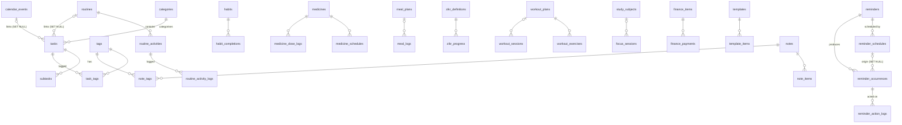

# Hayat — Database Design

Single Room database `HayatDatabase` (`core/database`), file `hayat.db` in app-private storage.
Schema JSON is exported to `core/database/schemas/` and checked into git; every version bump
requires a `Migration` plus a migration test. `fallbackToDestructiveMigration` is **never** used.

## Conventions

| Concern | Rule |
|---|---|
| IDs | `TEXT` UUID v4 (`IdGenerator`), except `reminders.request_code` (unique `INTEGER` used for PendingIntent identity). |
| Instants | `INTEGER` epoch milliseconds, UTC (`*_at` columns). |
| Local dates / times | ISO-8601 `TEXT` (`2026-11-23`, `08:00`). Sorts lexicographically = chronologically. |
| Weekday sets | `INTEGER` bitmask, Monday = bit 0 … Sunday = bit 6 (`WeekdaySet`). |
| Enums | `TEXT` enum names (stable across reorderings). |
| Money | `INTEGER` minor units + `TEXT` ISO currency code. Never floating point. |
| Soft delete | `deleted_at` on user-facing aggregates; rows are purged 30 days later by the maintenance worker. Queries exclude soft-deleted rows. |
| Foreign keys | Enabled (Room default). Children `ON DELETE CASCADE`; optional links `ON DELETE SET NULL`. Every FK column is indexed. |
| Transactions | Multi-table writes (`@Transaction` DAO methods / `withTransaction`) — e.g. saving a task with subtasks and tags, linking medicine schedules to reminders, restoring backups. |

## Entity–relationship overview

Reminders link to their owner generically through `(target_type, target_id)` (e.g.
`MEDICINE`/medicine id, `TASK`/task id). This keeps the reminder engine reusable by every
module without a nullable FK column per feature. Owners delete their linked reminders in
the same transaction (`ReminderLinker`).

## Tables

| Group | Tables |
|---|---|
| Organisation | `categories`, `tags`, `tasks`, `subtasks`, `task_tags`, `routines`, `routine_activities`, `routine_activity_logs`, `templates`, `template_items` |
| Reminder engine | `reminders`, `reminder_schedules`, `reminder_occurrences`, `reminder_action_logs`, `alarm_delivery_logs` |
| Health | `water_goals`, `water_logs`, `medicines`, `medicine_schedules`, `medicine_dose_logs`, `meal_plans`, `meal_logs`, `shopping_items`, `sleep_entries`, `workout_plans`, `workout_exercises`, `workout_sessions` |
| Ibadah | `prayer_logs`, `zikr_definitions`, `zikr_progress`, `quran_logs`, `fasting_logs` |
| Productivity | `habits`, `habit_completions`, `study_subjects`, `focus_sessions`, `finance_items`, `finance_payments`, `calendar_events`, `notes`, `note_items`, `note_tags`, `journal_entries`, `mood_entries` |
| System | `backup_metadata` |

Preferences (theme, language, dashboard layout, prayer settings, water reminder window,
app-lock configuration, etc.) are in Jetpack DataStore, not Room — they are single-row
configuration, not records.

### Key tables in detail

**reminders** — definition only: `id, title, description, category, target_type, target_id,
priority, enabled, style (NOTIFICATION|ALARM), vibrate, snooze_minutes, requires_completion,
request_code UNIQUE, created_at, updated_at, deleted_at`.

**reminder_schedules** — one row per rule: `type (ONCE|DAILY|WEEKLY|MONTHLY|YEARLY|INTERVAL),
local_time, start_date, end_date, weekdays, every_n, interval_minutes, window_start,
window_end, day_of_month, month, month_overflow (CLAMP|SKIP), zone_policy (DEVICE|FIXED),
zone_id`. "Multiple times per day" = multiple rows.

**reminder_occurrences** — `id, reminder_id, schedule_id?, scheduled_at, local_date,
local_time, status (SCHEDULED|SNOOZED|DELIVERED|COMPLETED|SKIPPED|MISSED|CANCELLED),
precision (EXACT|INEXACT|UNSCHEDULED), delivered_at, completed_at, snoozed_until,
attempt_count, updated_at`. `UNIQUE(reminder_id, scheduled_at)` makes materialisation
idempotent and prevents duplicates. Index `(status, scheduled_at)` serves the scheduler.

Delivery (`delivered_at`) and completion (`completed_at`, status) are separate: a delivered
or dismissed notification is **never** treated as completion.

## Migration policy

1. Bump `HayatDatabase.VERSION`, add `Migration(n, n+1)` in `Migrations.kt`.
2. Build to export the new schema JSON; commit it.
3. Add a case to `MigrationTest` using `MigrationTestHelper` with the exported schemas.
4. Backups record `schemaVersion`; restore of an older backup maps through
   `BackupMigrations`; a newer backup is rejected with a clear message.
